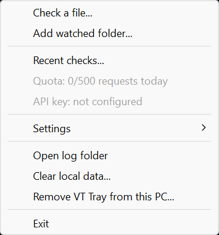
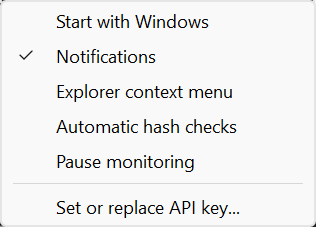
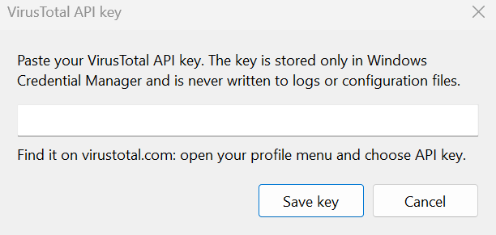
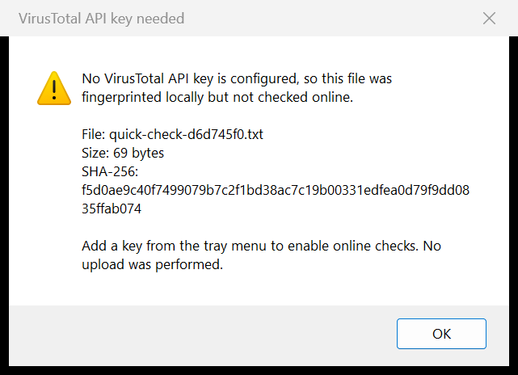
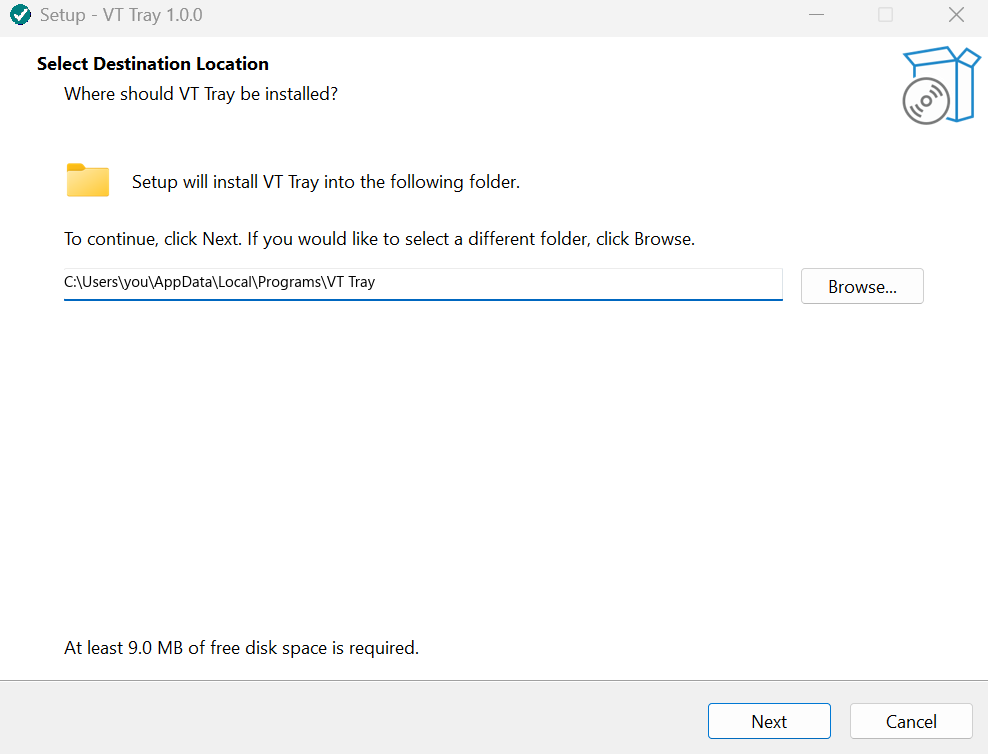

# VT Tray

[](https://github.com/abusayed0206/vtray/actions/workflows/ci.yml)
[](https://github.com/abusayed0206/vtray/releases/latest)
[](LICENSE)

A small, always-on Windows tray app that checks files against [VirusTotal](https://www.virustotal.com).
It watches the folders you choose, fingerprints new programs locally, and looks up only their
hashes. **Nothing is ever uploaded without your explicit confirmation for that file.**

**Website:** <https://vtray.sayed.app> · **Download:** [latest release](https://github.com/abusayed0206/vtray/releases/latest)

<p align="center">
  
  
</p>

## Features

- **Hash-first checks.** Check any file from the tray or Explorer; only its SHA-256 is sent.
- **Consent before every upload.** Unknown files can be uploaded after a per-file confirmation
  (name, size, fingerprint, community-sharing warning; *No* is the default). The report opens
  automatically when the analysis finishes.
- **Folder monitoring.** New executables and scripts in watched folders are announced once,
  after they stop changing. Optional automatic hash lookups are off by default.
- **Explorer integration.** *Check with VT Tray* (hash-only, never uploads) and
  *Upload with VT Tray...* (always asks first) under *Show more options*.
- **Respects the free API limits.** One persistent quota gate (4/min, 500/day, 15.5K/month),
  a 100-request manual reserve, and warnings before limits are reached.
- **Private by design.** The API key lives in Windows Credential Manager; logs and settings never
  contain it, and only file names (never folder paths) are sent.
- **Tiny.** About 0.4 MB working set and 2 MB private memory, 0% CPU while idle (measured in CI).
- **Leaves nothing behind.** Uninstall (or *Remove VT Tray from this PC*) removes startup and
  Explorer entries, the key, settings, cache, and logs.

<p align="center">
  
  
</p>

## Install

1. Download `VTray-Setup-<version>.exe` from the [latest release](https://github.com/abusayed0206/vtray/releases/latest).
2. Run it. It installs for your account only (no administrator rights) and adds a Start menu
   shortcut. Uninstall from **Settings > Apps > VT Tray**.
3. Right-click the tray icon > **Settings > Set or replace API key...** and paste your
   [VirusTotal API key](https://www.virustotal.com/gui/my-apikey).

A portable `VTray-<version>-portable.exe` is attached to each release as well.

<p align="center"></p>

## Build from source

Requires Windows 10/11 x64, Rust stable (MSVC), and the Windows SDK.

```powershell
cargo test
cargo build --release                                        # target\release\VTray.exe
cargo run --release --example memprobe -- 60                 # idle memory/CPU budget check
& "$env:LOCALAPPDATA\Programs\Inno Setup 6\ISCC.exe" installer\vtray.iss   # dist\VTray-Setup-1.0.0.exe
```

Tests run against a local mock VirusTotal server; no real API key or network access is needed.
CI (`.github/workflows/ci.yml`) runs formatting, clippy, tests, the release build, the installer
build with a silent install/uninstall check, and the memory budget. Tags `v*` publish a release.

## Design documents

- [docs/SPEC.md](docs/SPEC.md): what VT Tray must do (requirements and success criteria).
- [docs/PRINCIPLES.md](docs/PRINCIPLES.md): the rules every change follows: consent before upload,
  quota discipline, privacy, low resource use, no destructive actions.

## License

[MIT](LICENSE) © 2026 [abusayed.dev](https://abusayed.dev). VT Tray is not affiliated with
VirusTotal or Google. VirusTotal results are advisory reputation data, not a guarantee that a
file is safe or unsafe.
